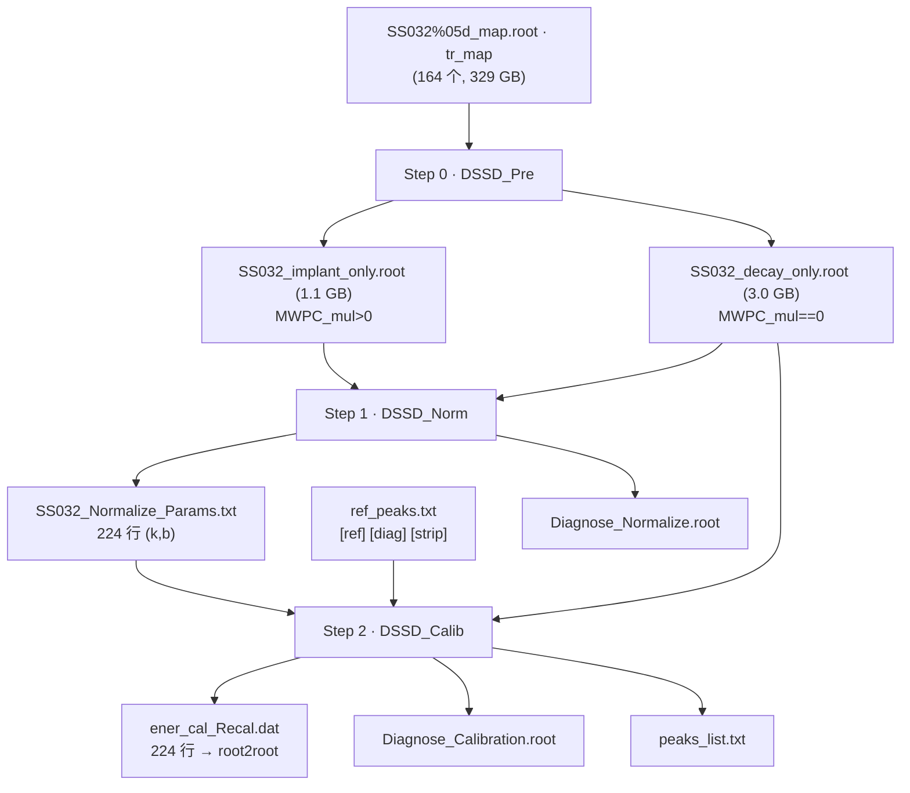

# DSSD 内刻度使用说明

本文是 `DSSD_recal_all` 的完整操作手册，覆盖"怎么编译、怎么配、三步各做什么、
结果怎么读、出问题怎么查"。算法层面的推导与代码定位见 [readme.md](readme.md)。

---

## 0. 这个程序解决什么问题

双面硅条探测器（DSSD）的 X 面 128 条、Y 面 48 条各自接一套前放，即使同型号，
每条链路的增益也有千分之几的差异。用内源的 α 线做刻度时，这个差异会直接变成
"同一个峰在不同条上落在不同位置"——本底 6 MeV 处 0.5% 的增益差就是 30 keV，
和峰本身的宽度同量级，不修掉就没法把两面或不同条的数据合起来看。

程序把这件事拆成两段，两段各自解决一个独立的问题：

| 段 | 解决的问题 | 数学形式 | 未知量 |
| --- | --- | --- | --- |
| **Step 1 归一化** | 同一条面上的各条增益彼此不一致 | `E_norm = k·E_raw + b` | 每条一个 `(k,b)`，共 224 组 |
| **Step 2 绝对刻度** | 整套归一化后的谱还没有物理能量标度 | `E_cal = K·E_norm + B` | **每个面**一组 `(K,B)`，共 3 组 |

第一段是相对的（只用 X、Y 两面在同一个像素上沉积相同能量的物理事实），第二段
是绝对的（用已知能量的 α 线）。最终写进表格的是两者复合的结果：

```
E_cal = K·(k·ADC + b) + B  =  (K·k)·ADC + (K·b + B)
        └──── k_total ────┘   └──── b_total ────┘
```

也就是 `ener_cal_Recal.dat` 里的两列 `k`、`b`，以及 root2root 使用的
`E = b + k·ADC`。

**为什么不能只做第二段**：绝对刻度只能给出一个面共用的一组系数，逐条差异消不掉；
而逐条拟合绝对刻度需要每条都有足够统计的独立峰——做不到。反过来只做第一段也不
行，归一化后的能量还是"以参考条为单位的任意标度"。

---

## 1. 快速开始

```bash
cd /home/evalie/Project/Function/Project/DSSD_recal_all

make                    # 编译三个可执行文件

./DSSD_Pre              # Step 0：164 个 map 文件 → 两个小文件（很慢，见 §5）
./DSSD_Norm             # Step 1：→ SS032_Normalize_Params.txt
./DSSD_Calib            # Step 2：→ ener_cal_Recal.dat

cp ener_cal_Recal.dat /path/to/root2root_202407/    # 交给下游
```

`make run` 等价于三步连跑，但**包含很慢的 Step 0**，日常调试请单独跑后两步。

如果 `SS032_decay_only.root` 和 `SS032_implant_only.root` 已经存在且输入数据没变，
直接从 `./DSSD_Norm` 开始。

---

## 2. 环境、编译与 setup.h

### 2.1 需求

- ROOT（需要 `root-config`、`ROOTDataFrame`、`Spectrum` 库），编译器走
  `root-config --cflags` 给出的标准（当前是 C++20）。
- 输入数据：`INPUT_DIR_PATTERN` 指向的 `_map.root`，树名 `tr_map`。

### 2.2 编译

```bash
make            # 全部三个
make DSSD_Norm  # 只编一个
```

### 2.3 道号从哪来：直接吃 ANA 共享 `setup.h`

本程序不再自己维护道号区间，而是从 `root2root` / `Cal_Auto_*` 那一套共享的
`setup.h` 推导（`Config.h` 第 0 节）。两种用法，编译结果完全一样，区别只在
"谁是唯一真相"：

| 方式 | 怎么做 | 生效的文件 | 适用 |
| --- | --- | --- | --- |
| **A 直接引用**（默认） | 什么都不用做 | `-I $(ANA_SETUP_DIR)` 指向的共享文件 | 共享文件就在本机；上游一改，下次 make 自动跟上 |
| **B 本地快照** | `make sync-setup` | 本目录的 `./setup.h` | 与 ANA 其它程序"每个目录各带一份"的约定一致；打包/换机器不用带路径 |

```bash
make sync-setup                    # 快照，并写下 setup_stamp.txt（源/md5/时间）
make unsync-setup                  # 删除快照，回到方式 A
make ANA_SETUP_DIR=/别的路径 all    # 换机器/换版本
```

启动日志会说明用的是哪份：

```text
# 方式 A
--> [setup.h] 已加载 ANA 共享 setup.h
    DSSD X 0-127, Y 128-175, YH 176-223 (共 224 道)

# 方式 B
--> [setup.h] 本地快照 ./setup.h（快照于 2026-11-13 17:20:31 CST），源: /.../Cal_Auto_DSSD_Normalize/setup.h
    DSSD X 0-127, Y 128-175, YH 176-223 (共 224 道)
```

makefile 用 `.setup_state` 记录"当前生效的是哪份、md5 多少"。**切换模式、或上游
`setup.h` 内容变了，都会自动触发重编**——不会出现"改了 setup.h 却还在跑旧对象
文件"这种最难查的问题。

由 `setup.h` 派生的常量（不要在别处另写数字）：

| 常量 | 含义 | 当前值 |
| --- | --- | --- |
| `CH_BASE_X` / `CH_BASE_Y` / `CH_BASE_YH` | 三面在全局道里的起点 | 0 / 128 / 176 |
| `NUM_DSSDX_POS` / `NUM_DSSDY_POS` / `NUM_DSSDYH_POS` | 每面条数 | 128 / 48 / 48 |
| `TOTAL_DSSD_CH` | 三面全局道上界，也是输出表行数 | 224 |
| `OUTPUT_DAT_FILE` | 最终刻度文件名，取 `RECONVERT_CALIBRATION_FILENAME` | `ener_cal_Recal.dat` |

> `TOTAL_DSSD_CH` 不能叫 `TOTAL_CH`：共享 `setup.h` 的 `TOTAL_CH` 是整个 DAQ 的
> 道数（39 板 × 8 道 = 312），同名会冲突。

---

## 3. 数据流与文件清单



| 文件 | 方向 | 说明 |
| --- | --- | --- |
| `SS032%05d_map.root` | 输入 | 每个 run 一个，树 `tr_map` |
| `SS032_implant_only.root` | Step 0 产出 | 注入事件（有 MWPC），1.1 GB |
| `SS032_decay_only.root` | Step 0 产出 | 衰变事件（无 MWPC），3.0 GB |
| `SS032_Normalize_Params.txt` | Step 1 产出 | 5 行注释 + 224 行 `Ch k b` |
| `ref_peaks.txt` | **人工维护** | 参考峰/诊断峰/逐条检查峰，运行期读取，改完不用重编译 |
| `ener_cal_Recal.dat` | Step 2 产出 | 224 行数据（**无表头**）+ 末尾 `#` 块 |
| `Diagnose_Normalize.root` | Step 1 产出 | 二维谱与逐条 Profile |
| `Diagnose_Calibration.root` | Step 2 产出 | 刻度前后总谱、拟合点、逐条谱 |
| `peaks_list.txt` | Step 2 产出 | 各面峰表 + 绝对刻度小结 |

---

## 4. 配置项总表

全部在 [Config.h](Config.h)，改完必须重新 `make`。参考峰不在这里，在 `ref_peaks.txt`。

| 变量 | 当前值 | 作用 / 什么时候改 |
| --- | --- | --- |
| `NUM_THREADS` | 10 | RDataFrame 线程数。内存吃紧时降到 4–6 |
| `INPUT_DIR_PATTERN` | `/home/evalie/Project/Document/After/SS032%05d_map.root` | 换实验必改 |
| `RUN_START` / `RUN_END` | 2 / 178 | 含两端；只跑部分 run 时缩小 |
| `TREE_NAME` | `tr_map` | |
| `DECAY_ONLY_FILE` / `IMPLANT_ONLY_FILE` | `SS032_*_only.root` | Step 0 产物名，换实验建议改名 |
| `NORM_PARAM_FILE` | `./SS032_Normalize_Params.txt` | |
| `NORM_MIN_E` / `NORM_MAX_E` | 4000 / 14000 keV | 归一化用的能量窗，要覆盖内源 α 线 |
| `NORM_E_DIFF` | 200 keV | 两面能量一致性窗（见 §6.4） |
| `NORM_MIN_ENTRIES` | 500 | 一条至少要这么多点才拟合；统计不足时降低 |
| `REF_STRIP_X` / `REF_STRIP_Y` | 10 / 23 | 星形桥接的两个"星心"条（见 §6.3） |
| `REF_PEAK_FILE` | `./ref_peaks.txt` | |
| `target_E` / `fit_win` | 6113 / 100 keV | 逐条 FWHM、dE 两列看哪个峰（可被 `[strip]` 覆盖） |
| `HIST_BINS` / `HIST_MIN` / `HIST_MAX` | 2000 / 4000 / 14000 | Step 2 总谱与逐条谱的栅格（5 keV/bin） |
| `REF_DUP_SIGMA` | 2.0 | 两个参考点落在同一个峰上时按 sigma 判重 |
| `REF_MIN_POINTS` | 2 | 少于这么多峰就无法拟合（硬性） |
| `REF_GOOD_POINTS` | 3 | 少于这么多峰没有冗余，只警告 |
| `REF_WARN_SPAN_KEV` | 800 | 参考峰跨度低于此值只警告"杠杆不足" |
| `REF_WARN_RESID` / `REF_WARN_K_TOL` / `REF_WARN_B_TOL` | 8 / 0.05 / 200 | 残差、增益、零点的**提示**阈值，不否决 |

### 4.1 ref_peaks.txt

```ini
[ref]
8783.0    30.0      # 能量(keV)  搜索半窗(keV)
7065.0    30.0
7128.0    30.0

[diag]
6113.0    40.0
7686.0    40.0
5304.0    40.0

[strip]
6113.0   100.0
```

| 节 | 用途 |
| --- | --- |
| `[ref]` | **参与**平面绝对刻度的 `pol1` 拟合。至少 2 个能定位的峰 |
| `[diag]` | **不参与**拟合，只做事后验收；残差写进 `peaks_list.txt` |
| `[strip]` | 逐条一致性检查（输出表 `FWHM`、`dE` 两列）用哪个峰 |

三点注意事项：

1. **峰间隔决定斜率精度**。两点相隔 Δ 时，增益误差约为 `√2·δE/Δ`；8783 与
   7065 跨 1718 keV，而 7065 与 7128 只隔 63 keV——后者单独用没有杠杆，实测它
   给出的局域增益比全局值低 3.2%，是 6 MeV 处约 ±9 keV 系统误差的来源。日志会
   用 `[WARN]` 明确指出是哪一对点。
2. **`[diag]` 故意放 α 线**（6113 / 7686 / 5304），这样它们对刻度是独立检验，
   而不是"用 6113 校 6113"的自我实现。若把 α 线挪进 `[ref]`，`[diag]` 残差就
   没有意义了。
3. 文件缺失、某节为空 → 退回 `Config.h` 里的 `REF_PEAKS_DEFAULT` /
   `DIAG_PEAKS_DEFAULT`，并打 `[WARN]`，不会静默。

---

## 5. Step 0：预筛选（`./DSSD_Pre`）

把 164 个 `_map.root`（329 GB）压成两个小文件，只保留后续两步真正要用的 12 个
分支。**这是最慢的一步**（读 329 GB，小时量级），也是唯一一步"输入变了才需要
重跑"。

### 5.1 筛选条件

```
注入:  MWPC_mul > 0  && DSSDX_mul == 1 && DSSDY_mul == 1 && Veto_mul == 0 && SSD_mul == 0
衰变:  MWPC_mul == 0 && DSSDX_mul == 1 && DSSDY_mul == 1 && Veto_mul == 0 && SSD_mul == 0
```

逐条的理由：

- `DSSDX_mul == 1 && DSSDY_mul == 1`：**只留两面各一根条的单重事件**。这是
  Reese 2015 明确要求的——条间击中（interstrip）的事件会在同一像素里给出错能量，
  污染归一化本底（Torresi 2013 讨论的正是这类事件的响应）。本程序用上游的
  multiplicity 直接把这类事件切掉，比事后修正更干净。
- `Veto_mul == 0`：去掉穿过 Veto 的粒子，避免把非 α 的能损混进谱里。
- `SSD_mul == 0`：α 从 DSSD 逃逸、剩余能量落在侧面硅里时，DSSD 里只留下残缺的
  能量，必须排除。
- `MWPC_mul > 0 / == 0`：注入（有 MWPC 符合）与衰变（无 MWPC）分开存两个文件，
  因为两者在 Step 1 里要一起用（样本更大），而 Step 2 只用衰变（见 §7.5）。

### 5.2 产物与注意

```text
SS032_implant_only.root   1.1 GB
SS032_decay_only.root     3.0 GB
```

- **`INPUT_DIR_PATTERN` 是"模板"，不是目录扫描**：程序按 `RUN_START..RUN_END`
  逐个拼出 `SS032%05d_map.root`（run=2 → `SS03200002_map.root`），拼出来的文件
  不存在就跳过。所以改了数据目录必须改这一行，只把文件放进去是没用的。
- 启动时会打印实际找到多少：`--> Input files: 164 / 177 (run 2..178)`，缺号超过
  0 个还会列出前 8 个。`RUN_END` 设小了会**静默截断**数据，靠这一行才能发现。
- 输出用 `Snapshot` 只拷贝 12 列，所以后面两步很快（Step 2 只需十几秒）。
- 前台跑会阻塞很久，建议 `nohup ./DSSD_Pre > pre.log 2>&1 &`。
- `make clean_Pre` 会删掉这两个文件；删了就要重跑（几十分钟到小时）。
- 只改了 run 范围或换了输入目录 → 必须重跑；只改了 `ref_peaks.txt` 或 `Config.h`
  里的刻度参数 → **不用**重跑。

---

## 6. Step 1：逐条相对归一化（`./DSSD_Norm`）

输入两个文件（注入 + 衰变，合起来 1.75 亿条），输出每条一个 `(k,b)`。

### 6.1 原理：星形桥接

同一个像素上 X 条与 Y 条沉积的是**同一份能量**：

```
E = k_i · ADC(X_i) + b_i = k_j · ADC(Y_j) + b_j
⇒ ADC(X_i) = (k_j/k_i)·ADC(Y_j) + (b_j-b_i)/k_i
```

所以在固定的 Y 参考条（`REF_STRIP_Y = 23`）上，把 `E_Y` 对 `E_X` 做直线拟合，
得到的斜率就是 `k_i/k_ref`、截距是零点差——这就是"一条 X 条的相对增益"。
Y 面同理（用 `REF_STRIP_X = 10` 固定 X 条）。

这样每个面都只剩一个自由度：**所有条相对同一个参考条标定**。参考条自身的绝对
增益交给 Step 2。

### 6.2 具体做法

```text
对每条 X_i（128 条）:  E_Y(ChY=23) vs E_X(ChX=i)  → TH2F(200×200, 50 keV/bin)
                        TProfileX + pol1 → (k, b)
对每条 Y_j（48 条）:   E_X(ChX=10) vs E_Y(ChY=j)  → 同上
对每条 YH_m（48 条）:  E_X(ChX=10) vs E_YH(ChYH=m) → 同上
```

拟合结果的接受条件：`TFitResultPtr` 有效且 `|slope| > 0.1`（防呆：斜率应该在 1
附近，出现 0 说明 Profile 是空的或退化）。每条 10 个 slot 的直方图会先合并再拟合。

### 6.3 桥接（把 Y 面拉到 X 面的标度上）

上面两步得到的 X 参数以 RefY 为单位、Y 参数以 RefX 为单位，两者差一个整体因子。
用参考条之间的关系消掉它：

```
k_bridge = x_res[REF_STRIP_X].k        b_bridge = x_res[REF_STRIP_X].b
y_res[i].k = k_bridge · k_old          y_res[i].b = k_bridge · b_old + b_bridge
```

即"先把 Y 条刻到 RefX 的标度，再套用 RefX 自己的 (k,b)"。数学上就是把
`RefY = k·RefX + b` 复合进 `RefX = k_y·Y_i + b_y`。

对应日志：

```text
[OK] Bridge parameters (Ref_X -> Ref_Y): k=0.998741, b=5.97078
```

**参考条怎么选**：要求统计量大、分辨好、周围没有 Veto 缝隙（`Config.h` 的注释
提到 X40、X90 附近有缝隙）。当前 10 / 23 是实测可用的。若桥接失败（`k_bridge`
太小或 RefX 本身没拟合出来），会打 `[WARNING]` 并且**不做**Y 面修正，此时 Y 面
与 X 面标度不一致，结果不可用。

### 6.4 两个容易误解的设定

- **`NORM_E_DIFF = 200 keV` 的窗**：这条要求两面能量之差小于 200 keV。它割在
  "待测量"上，概念上会带来截断偏置。实测这个像素上 `E_Y−E_X` 的展宽是
  rms 28 keV、在最热的一对条上是 7σ，几乎不切事件，偏置可以忽略——但它确实
  应该被当成"保守筛选"而不是"无偏估计"。若哪天把窗收到 100 keV 以下就要重新
  评估。
- **Step 1 用注入+衰变，Step 2 只用衰变**：这不是漏改。Step 1 要的是统计量
  （相对增益与入射粒子种类无关），Step 2 要的是干净的内源 α 谱（注入事件的
  能量分布会被 MWPC 触发条件偏置）。两段的样本不同是**故意的**。

### 6.5 坏条处理

拟合不出来的条（统计不足、Profile 退化）会被记为坏条，然后用**左右最近的好条
按距离线性插值**补上：

```text
# Bad Y: 3
# Bad YH: 3
# Bad YH: 28
# 坏条已用左右最近好条按距离线性插值，不是 (1,0)
```

旧版把这些条留在 `(1,0)`，等于宣布"这条的增益和参考条一模一样"，而真实偏差是
0.5% 量级（30 keV）——比插值差得多。日志会汇总：

```text
--> Fitted strips: X 128/128, Y 47/48, YH 46/48
--> Y: 1 条用邻道插值补齐
```

### 6.6 产物

```text
SS032_Normalize_Params.txt     # 注释若干行 + 224 行数据
Diagnose_Normalize.root        # h2_X_*/h2_Y_* 二维谱、Profile 图
```

数据行格式 `Ch k b`，含义 `E_norm = k·E_raw + b`。`0–127` = X，`128–175` = Y，
`176–223` = YH。Step 2 的 `LoadNormParams()` 读它，读到的道数会打印出来：

```text
--> Normalization loaded: X=128/128  Y=48/48  YH=48/48
```

---

## 7. Step 2：平面绝对刻度（`./DSSD_Calib`）

只读衰变文件（内源 α 谱干净），配合 Step 1 的参数和 `ref_peaks.txt`。

### 7.1 流程

```text
1. 逐事件：E = norm.k·ADC + norm.b → 填三面总谱（h_tot_X / h_tot_Y / h_tot_YH）
2. 对每个面：在 [ref] 给出的能量附近找峰（gaus + pol1 本底）
3. 去掉"两个参考点认到同一个物理峰"的重复
4. 用被接受的 (实测, 标称) 点做 pol1 → (K, B)
5. 报告：残差、相邻点局域增益、K/B 是否偏离 (1,0)
6. 用 (K,B) 精确移轴重写谱（h_calib_*），再找 [diag] 的峰做验收
7. 逐条：在 6113 keV 附近量 FWHM 和峰位偏差 → 输出表第 4、5 列
8. 写 ener_cal_Recal.dat
```

### 7.2 参考峰去重（这是旧版最严重的 bug）

7065 与 7128 只差 63 keV，而谱峰 FWHM 已经 30 keV 量级，两个 ±60 keV 的搜索窗
大面积重叠。旧版做法是"在窗内找最高的峰"，于是 YH 面的两个窗都落到同一个峰
（7099.70 keV）上，三点拟合退化成两点、给出 `K=0.9723, B=+193.59`，把整面谱
压错了 5%（旧版 `h_calib_YH` 的最强峰跑到了 4617 keV）。

现在的做法：先把找到的峰按能量排序，若新点与已接受点的距离小于
`REF_DUP_SIGMA × sigma`，判为同一个峰并丢弃：

```text
[SKIP] YH: 找不到 7065 keV 附近的峰
[SKIP] YH: 找不到 7128 keV 附近的峰
[FALLBACK] YH: 可用参考峰 1 < 2，直线都定不出来，无法独立定 K/B
[INHERIT] YH: 沿用 X 面刻度 K=0.999372 B=-24.6111 keV
```

**YH 面看到 `[INHERIT]` 是正常的、也是想要的行为**：YH 的 FWHM 有 38–52 keV，
物理上分不开 7065/7128 这一对；强行自己拟合会得到约 1.4% 的假增益。它上面唯一
能用的参考峰（8783）本身还是个宽混合结构。所以让 YH 沿用 X 面刻度是实测支撑的
最佳选择，前提是 YH 与 X 用的是同一个内源 α 谱（同一次刻度）。

### 7.3 检查项：只报告，不否决

只有两种情况会弃用拟合结果：**能定位的参考峰少于 2 个**（直线都定不出来），
或者拟合给出非物理的 `K ≤ 0` / 非有限值。

其余全部只打印 `[WARN]`，结果照用：

```text
[WARN] X: 相邻参考峰 7065->7128 keV 的局域增益 0.967234 比全局 0.999372 偏 -3.21589%（该对点间距仅 63 keV）
[WARN] X: 参考峰跨度仅 63 keV < 800 keV，斜率杠杆不足，K 的误差会被放大
[WARN] X: 单点最大残差 9.3 keV > 8 keV，参考峰可能有位移或被别的峰污染
[WARN] X: K=0.967 B=204 偏离 (1,0) 较远 —— 若输入是未做外刻度的原始 ADC，这是正常的（结果照用）；若不是，检查参考峰是否对错了线
```

**为什么不做硬性否决**：本程序同样会被用来处理**未做外刻度的原始 ADC**——那种
情况下 `K/B` 偏离 `(1,0)` 恰恰是应该的，如果把它当错误否决掉，反而会得出一张
"看起来正常、其实是 `k=1,b=0`"的假表。程序只负责把偏离喊出来，怎么解读交给
使用者。

### 7.4 精确移轴

`ApplyCalibration` 不是"按 bin 中心重填"，而是把每个 bin 的**下边**变换成
`K·lowEdge + B` 后重建坐标轴，所以刻度不会引入额外的 5 keV 量化（旧版正是这个
量化让 `peaks_list.txt` 里"归一化"与"刻度后"两段恰好差 30.00 keV）。

### 7.5 逐条诊断

对每条（224 条）在 `[strip]` 指定的峰（默认 6113 keV，半窗 100 keV）附近找峰：

- `FWHM`：2.355σ。6 MeV 重离子峰不可能超过 200 keV，超过的判为噪声假峰并记 0。
- `dE`：峰位与标称值之差（keV）。0 表示没测到峰。

实测分布（SS032）：X 中位 28.8 keV（127/128 条测到）、Y 中位 35.6（43/48）、
YH 15/48（YH 本身分辨差，且只有一半条有足够统计）。

### 7.6 产物

```text
ener_cal_Recal.dat          # 224 行数据 + 末尾 # 块
Diagnose_Calibration.root   # h_tot_* / h_calib_* / gr_calib_* / Strips_Calib/
peaks_list.txt              # 各面峰表 + Absolute Scale 小结
```

---

## 8. 结果怎么读

### 8.1 ener_cal_Recal.dat

**第一行就是数据**，共 224 行，之后才是 `#` 注释块：

```text
0	-14.8691	0.9973	27.1789	-6.4519
...
176	5.0615	0.9938	28.8	1.2
# ------------------------------------------------------------------
# Ch  b  k  FWHM  dE_6113
# ...
```

| 列 | 含义 |
| --- | --- |
| `Ch` | 全局道号 0–127(X)、128–175(Y)、176–223(YH) |
| `b` | 截距（keV），对应 `E = b + k·ADC` |
| `k` | 斜率（keV/ADC） |
| `FWHM` | 该条 6113 keV 峰的宽度，0 = 没测到 |
| `dE` | 该条峰位偏差（keV），0 = 没测到 |

> **为什么表头放末尾**：root2root 的 `Read_Par_From_File()` 用
> `sscanf("%d\t%lf\t%lf\t")` 且**不检查返回值**。表头在第一行时，`ch`/`par` 还是
> 未初始化的栈内容，可能写坏任意一个道。把数据放最前面，后面 `#` 行解析失败时
> 只会把最后一个道的值原地重写一次。

### 8.2 交给 root2root

```bash
cp ener_cal_Recal.dat /path/to/root2root_202407/
```

三条硬约束：

1. **文件名不能改**：来自 `setup.h` 的 `RECONVERT_CALIBRATION_FILENAME`，两边
   必须一致。
2. **必须放在 root2root 的运行目录**：它是按当前工作目录读的，不是按绝对路径。
3. **不能加表头**（见上）。

### 8.3 peaks_list.txt

顶部是逐面峰表（`Rank / Pos(Fitted) / Height(Raw) / Sigma / FWHM`），中途是三段
`--- X/Y/YH Absolute Scale ---`，写法：

```text
--- X Absolute Scale ---
K=0.999372  B=-24.6111 keV  n_ref=3  span=1718.0 keV  fit_rms=0.86 keV
  diag  6113.0 keV : residual -1.8 keV
  diag  7686.0 keV : residual -3.3 keV
  diag  5304.0 keV : residual +0.5 keV
  diag rms = 2.19 keV
```

看的是 `[diag]` 残差：三条 α 线都没参与拟合，如果它们残差互相矛盾（比如一条 +8
一条 −8），说明刻度形状有问题，而不是整体平移。

### 8.4 诊断 ROOT

| 对象 | 看什么 |
| --- | --- |
| `h_tot_X` / `h_calib_X` | 刻度前后总谱。最强峰应从 ~6137 移到 6113 附近 |
| `gr_calib_X` | 被接受的参考点 `(实测, 标称)`，以及它们偏离拟合线的程度 |
| `Strips_Calib/h_strip_N` | 单条刻度的谱，FWHM 异常的条在这里看 |
| `h_fwhm` | FWHM 分布，用来找离群条 |

---

### 本机设置写在哪：`MyConfig.h`

`Config.h` 是**代码的一部分**，换机器/换批次时不要去改它——否则下次升级程序一覆盖，
你的路径就没了（症状通常是编译报 `'Print_Channel_Map' was not declared` 这种"新旧
文件版本对不上"的错）。

正确做法：把本机专属设置放在单独的 `MyConfig.h` 里，它不会被覆盖，也不进版本库。

```bash
cp MyConfig.h.example MyConfig.h
vim MyConfig.h        # 只改 MY_INPUT_DIR_PATTERN 和 MY_RUN_END
make -B
```

`MyConfig.h` 能覆盖的项：`MY_INPUT_DIR_PATTERN`、`MY_RUN_START`、`MY_RUN_END`、
`MY_NORM_MIN_E`、`MY_NORM_MAX_E`、`MY_NORM_E_DIFF`、`REF_STRIP_X`、`REF_STRIP_Y`。
启动时第二行会明确告诉你用了哪一套：

```
--> [MyConfig.h] 已加载本地配置          ← 用的是 MyConfig.h
--> [MyConfig.h] 未找到，使用 Config.h 默认路径   ← 用的是 Config.h
```

**升级程序时**：整体覆盖 `*.cpp` / `*.h` / `makefile` / `ref_peaks.txt`，
保留自己的 `MyConfig.h`，再 `make -B` 即可。

### 找不到输入文件（`No input files found`）三步排查

1. **看报错里烧进去的路径**。新版本会把 `INPUT_DIR_PATTERN`、run 范围、"第一个期望
   文件"、以及那个目录里真实存在的前几个文件名全打出来。逐字比对数字位数与前后缀。
2. **确认程序是刚编的**。启动第二行会打印 `--> 本程序编译于 <日期> <时间>`。如果这个
   时间不是你刚才 `make` 的时刻，说明跑的是旧二进制 —— 常见于 `Config.h` 是通过解压/
   上传/git 恢复来的，mtime 比可执行文件还旧，make 判定"无需重编"而静默跳过。
   强制重建：

   ```bash
   make -B DSSD_Pre      # 或 touch Config.h && make
   ```

   再验证二进制里烧进去的路径确实改过了：

   ```bash
   strings DSSD_Pre | grep SS032%05d
   ```

3. **别把"文件在目录里"当成"程序会去找"**。`INPUT_DIR_PATTERN` 是模板，程序按
   `RUN_START..RUN_END` 逐个拼路径，从不 `ls` 目录。目录里同时存在 `_map/_tmp/_chain/
   _Rechain` 四种产物，只有 `_map.root` 是 Step 0 的输入。

## 9. 日志速查

| 前缀 | 出现在 | 含义 | 该怎么做 |
| --- | --- | --- | --- |
| `[OK]` | Step 1/2 | 拟合成功 | — |
| `[WARN]` | 各处 | 有问题但结果照用 | 逐条看文字判断；刻度类警告见 §7.3 |
| `[SKIP]` | Step 2 | 参考峰被判为重复/找不到 | YH 上正常；X/Y 上出现要查 `ref_peaks.txt` |
| `[FALLBACK]` | Step 2 | 点数不足，无法独立定 K/B | 检查参考峰是否与谱对得上 |
| `[INHERIT]` | Step 2 | 沿用 X 面刻度 | YH 上正常 |
| `[ERROR]` | 各处 | 无法继续 | 见下 |

常见 `[ERROR]`：

| 日志 | 原因 | 处理 |
| --- | --- | --- |
| `[ERROR] No input files found.` | `INPUT_DIR_PATTERN` 或 run 范围不对 | 报错里会直接给出模板、范围和"第一个期望文件"的完整路径 |
| `Cannot open output file` | 没有写权限/目录不对 | 检查工作目录 |
| `三个平面都没有得到独立刻度，输出表将全是 k=1, b=0（未刻度）` | 所有面的参考峰都没认到 | 检查 `ref_peaks.txt` 与输入数据是否匹配 |
| `K=... 非物理结果，弃用` | 拟合退化 | 检查参考峰是否重复或谱是否为空 |
| `Undefined` / 树里缺分支 | 输入不是 `tr_map` | 确认 `TREE_NAME` |

---

## 10. 常见任务

### 10.1 换一个实验（比如 SS038）

```bash
# 1) 改 Config.h：INPUT_DIR_PATTERN、RUN_START/END、文件名前缀、REF_STRIP_X/Y
# 2) 改 ref_peaks.txt：[ref]/[diag] 的能量换成该实验内源 α 线的能量
# 3) 若换探测器，确认 setup.h 的道号区间还是不是 0-127 / 128-175 / 176-223
make && ./DSSD_Pre && ./DSSD_Norm && ./DSSD_Calib
```

### 10.2 只重跑 Step 2（最常见）

改了 `ref_peaks.txt`、`Config.h` 的刻度参数、或 `SS032_Normalize_Params.txt`：

```bash
make && ./DSSD_Calib      # 十几秒
```

### 10.3 只重跑 Step 1

改了 `REF_STRIP_*`、`NORM_MIN_E`、`NORM_E_DIFF`、`NORM_MIN_ENTRIES`：

```bash
make && ./DSSD_Norm && ./DSSD_Calib
```

### 10.4 加一条参考峰

在 `ref_peaks.txt` 的 `[ref]` 里加一行 `能量 半窗`，重跑 Step 2。跨度变大，K 会
更稳；日志里的 `[WARN]` 局域增益会告诉你新点是否和旧点自洽。

### 10.5 想处理原始 ADC（不做外刻度）

把 `ref_peaks.txt` 的 `[ref]` 留空或直接删掉这个文件，程序会退回
`REF_PEAKS_DEFAULT`；如果连那些峰都不存在，会走 `[FALLBACK]` →
`[ERROR] 三个平面都没有得到独立刻度`，输出表就是 `k=1, b=0`——这正好就是
"直通"。若只想去掉绝对刻度而保留逐条归一化，也可以直接把
`SS032_Normalize_Params.txt` 当结果用（它的 `k,b` 是逐条相对增益）。

### 10.6 对比修改前后的结果

```bash
diff <(head -224 ener_cal_Recal.dat) <(head -224 _before_fix/ener_cal_Recal.dat)
```

`_before_fix/` 里存着修复前的全部源码和产物，可直接拷回回滚。

---

## 11. 已知限制

1. **YH 面无法独立刻度**。物理上 7065/7128 这一对在 YH 上分不开（FWHM 38–52
   keV），8783 又是个宽混合结构。当前策略是沿用 X 面 `(K,B)`。如果哪天换到
   YH 分辨更好的探测器，`[SKIP]`/`[INHERIT]` 会自动消失，不需要改代码。
2. **绝对刻度在 6 MeV 处有约 ±9 keV 的系统误差**。来源是参考峰只有 3 个、其中
   一对间距仅 63 keV，峰位 ±2 keV 的误差按 `√2·δE/Δ` 传到斜率上就是
   δK≈0.0015。加参考峰可以缓解（§10.4）。
3. **X/Y 的 `(K,B)` 与旧版一致，没有变化**——这是刻意的：修复只影响 YH 和诊断
   信息，已经发布的结果表在 X/Y 上逐位不变（实测 diff 为空）。
4. **归一化的星形桥接是"两点定标"**，不像 Reese 2015 那样做全局 χ² 闭合。
   影响是：RefX/RefY 自身的增益误差会传播到整个面，且没有内部一致性检验。
   优点是不需要 GSL、不需要大规模网格搜索、单遍 RDataFrame 就能算完。
5. **`NORM_E_DIFF` 割在被测量上**（见 §6.4）。当前数据下影响可忽略，但换数据
   时应当用 `Diagnose_Normalize.root` 的 `h2_X_10` 重新确认展宽。
6. **Step 0 不做时间符合筛选**，完全依赖上游 `_map.root` 的符合分组与
   `mul` 分支。若上游的符合窗变了，这里的 `mul == 1` 语义也会跟着变。

---

## 12. 事故处理

| 情况 | 处理 |
| --- | --- |
| 输出表看起来是 `k=1, b=0` | 看 Step 2 日志有没有 `[ERROR] 三个平面都没有...`；多半是 `ref_peaks.txt` 对不上数据 |
| YH 的 `k` 和 X 面一模一样 | 正常，那是 `[INHERIT]`（旧版是 `193.59/0.9723`，那才是错的） |
| 某几条 `FWHM` 特别大 | 看 `Diagnose_Calibration.root` 的 `h_strip_N`；通常是边缘条或有 Veto 缝隙 |
| 结果和上次不一样 | 先确认 `ref_peaks.txt` / `SS032_Normalize_Params.txt` 有没有被改；`git diff` 看源码；必要时用 `_before_fix` 复跑对照 |
| 想完全重来 | `make clean_all && make && ./DSSD_Pre && ./DSSD_Norm && ./DSSD_Calib`（慢） |

---

## 附：与 ANA 参考程序的关系

`DSSD_recal_all` 与 `ANA_SHANS2_202602_v1.07.4/Cal_Auto_All_202412/Cal_Auto_DSSD_Normalize`
是同一套"逐条相对归一化 + 平面绝对刻度"的两段式，本程序可看作它的精简重写版。
本程序额外做了：`|EX−EY|`/能量/反符合窗、`gaus(0)+pol1(3)` 带本底拟合、TProfile
误差与 χ²/ndf、逐条 FWHM/dE 两列诊断、参考峰去重与门控/继承、坏条插值、参考峰表
外部化、直接吃共享 `setup.h`。没有吸收 ANA 的二维 `TH2F::Fit` 直接拟合与 fork
多进程，也没有合并 Step 0/1（保持三个独立阶段，便于单独重跑）。
